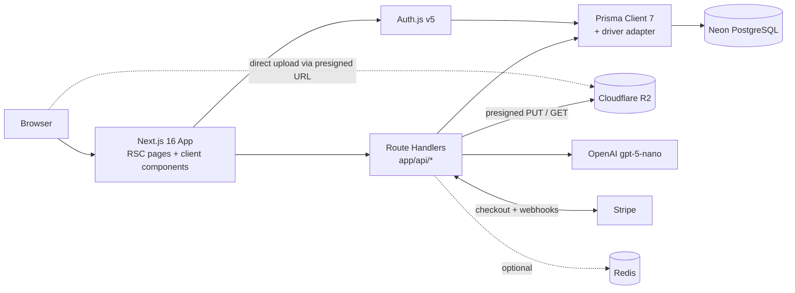
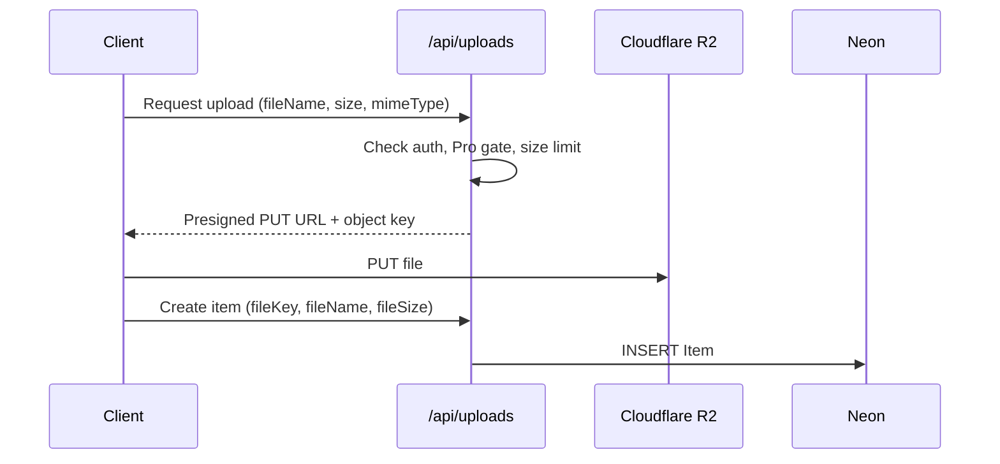
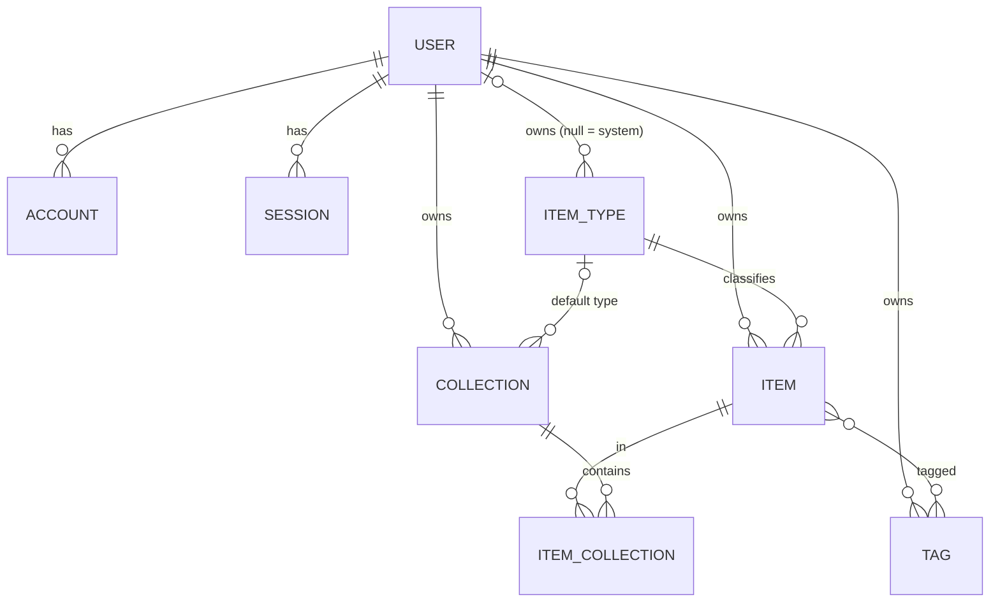

# DevStash — Project Overview

> One fast, searchable, AI-enhanced hub for all developer knowledge and resources.

---

## 1. Problem

Developers keep their essentials scattered across too many places:

| What | Where it usually lives |
|---|---|
| Code snippets | VS Code, Notion |
| AI prompts | Chat histories |
| Context files | Buried in project folders |
| Useful links | Browser bookmarks |
| Docs | Random folders |
| Commands | `.txt` files, bash history |
| Project templates | GitHub Gists |

The result: context switching, lost knowledge, and inconsistent workflows. **DevStash** replaces all of that with a single hub.

---

## 2. Target Users

| Persona | Primary need |
|---|---|
| **Everyday Developer** | Grab snippets, prompts, commands, and links fast |
| **AI-first Developer** | Save prompts, context files, workflows, system messages |
| **Content Creator / Educator** | Store code blocks, explanations, course notes |
| **Full-stack Builder** | Collect patterns, boilerplates, API examples |

---

## 3. Features

Legend: 🆓 Free · ⭐ Pro · 🔜 Later

### A. Items & Item Types

Every item has exactly one type. System types are seeded and **cannot be edited or deleted**. Custom types come later (🔜 ⭐).

| Type | Content kind | Route | Color | Icon | Tier |
|---|---|---|---|---|---|
| Snippet | `TEXT` | `/items/snippets` |  `#3b82f6` blue | [`Code`](https://lucide.dev/icons/code) | 🆓 |
| Prompt | `TEXT` | `/items/prompts` |  `#8b5cf6` purple | [`Sparkles`](https://lucide.dev/icons/sparkles) | 🆓 |
| Command | `TEXT` | `/items/commands` |  `#f97316` orange | [`Terminal`](https://lucide.dev/icons/terminal) | 🆓 |
| Note | `TEXT` | `/items/notes` |  `#fde047` yellow | [`StickyNote`](https://lucide.dev/icons/sticky-note) | 🆓 |
| Link | `URL` | `/items/links` |  `#10b981` emerald | [`Link`](https://lucide.dev/icons/link) | 🆓 |
| File | `FILE` | `/items/files` |  `#6b7280` gray | [`File`](https://lucide.dev/icons/file) | ⭐ |
| Image | `FILE` | `/items/images` |  `#ec4899` pink | [`Image`](https://lucide.dev/icons/image) | ⭐ |

Items open and are created inside a **drawer** for fast access without leaving the current view.

### B. Collections

- A collection can hold items of **any type**.
- An item can belong to **multiple collections** (many-to-many via `ItemCollection`).
- Examples: *React Patterns* (snippets, notes), *Context Files* (files), *Python Snippets* (snippets), *Interview Prep* (mixed).

### C. Search

Search across **title, content, tags, and type**. Free tier gets basic search; the "powerful" version (ranking, fuzzy matching) is the upgrade path. See [Open Questions](#12-open-questions).

### D. Authentication

- Email + password (Credentials provider)
- GitHub OAuth

### E. Core Features

- [ ] Favorite collections and items
- [ ] Pin items to top
- [ ] Recently used items
- [ ] Import code from a file
- [ ] Markdown editor for text types
- [ ] File upload for file types ⭐
- [ ] Export data (JSON / ZIP) ⭐
- [ ] Dark mode by default, light mode optional
- [ ] Add/remove an item to/from multiple collections
- [ ] See which collections an item belongs to

### F. AI Features ⭐

| Feature | Applies to |
|---|---|
| Auto-tag suggestions | All text items |
| Summaries | Notes, long snippets, files |
| Explain This Code | Snippets, commands |
| Prompt optimizer | Prompts |

Model: OpenAI `gpt-5-nano`.

---

## 4. Tech Stack

| Layer | Choice | Docs |
|---|---|---|
| Framework | Next.js 16 / React 19 (App Router, SSR + client components) | [nextjs.org/docs](https://nextjs.org/docs) |
| Language | TypeScript | [typescriptlang.org](https://www.typescriptlang.org/docs/) |
| Database | Neon (serverless PostgreSQL) | [neon.com/docs](https://neon.com/docs) |
| ORM | Prisma 7 | [prisma.io/docs](https://www.prisma.io/docs) |
| Auth | NextAuth / Auth.js v5 + Prisma adapter | [authjs.dev](https://authjs.dev) |
| File storage | Cloudflare R2 | [developers.cloudflare.com/r2](https://developers.cloudflare.com/r2/) |
| AI | OpenAI `gpt-5-nano` | [platform.openai.com/docs](https://platform.openai.com/docs) |
| Payments | Stripe | [docs.stripe.com](https://docs.stripe.com) |
| Styling | Tailwind CSS v4 + shadcn/ui | [tailwindcss.com](https://tailwindcss.com/docs) · [ui.shadcn.com](https://ui.shadcn.com) |
| Icons | Lucide | [lucide.dev](https://lucide.dev) |
| Cache | Redis (optional, only if needed) | — |

**Principles:** one repo, one codebase. Backend logic lives in Route Handlers (`app/api/*`) for item CRUD, file uploads, AI calls, and Stripe webhooks.

---

## 5. Architecture



### File upload flow (⭐)



---

## 6. Data Model

### Entity relationships



### Prisma schema (`prisma/schema.prisma`)

Written for Prisma 7: `prisma-client` generator with a required `output`, and the connection URL lives in `prisma.config.ts` instead of the schema.

```prisma
generator client {
  provider = "prisma-client"
  output   = "../src/generated/prisma"
}

datasource db {
  provider = "postgresql"
}

// ─────────────────────────────────────────────
// Enums
// ─────────────────────────────────────────────

enum ContentType {
  TEXT // snippet, prompt, note, command
  URL  // link
  FILE // file, image
}

// ─────────────────────────────────────────────
// Auth (Auth.js v5 Prisma adapter models + app fields)
// ─────────────────────────────────────────────

model User {
  id            String    @id @default(cuid())
  name          String?
  email         String    @unique
  emailVerified DateTime?
  image         String?
  passwordHash  String? // null for OAuth-only users

  // Billing
  isPro                Boolean @default(false)
  stripeCustomerId     String? @unique
  stripeSubscriptionId String? @unique

  createdAt DateTime @default(now())
  updatedAt DateTime @updatedAt

  accounts    Account[]
  sessions    Session[]
  items       Item[]
  itemTypes   ItemType[]
  collections Collection[]
  tags        Tag[]
}

model Account {
  userId            String
  type              String
  provider          String
  providerAccountId String
  refresh_token     String?
  access_token      String?
  expires_at        Int?
  token_type        String?
  scope             String?
  id_token          String?
  session_state     String?

  createdAt DateTime @default(now())
  updatedAt DateTime @updatedAt

  user User @relation(fields: [userId], references: [id], onDelete: Cascade)

  @@id([provider, providerAccountId])
}

model Session {
  sessionToken String   @unique
  userId       String
  expires      DateTime

  createdAt DateTime @default(now())
  updatedAt DateTime @updatedAt

  user User @relation(fields: [userId], references: [id], onDelete: Cascade)
}

model VerificationToken {
  identifier String
  token      String
  expires    DateTime

  @@id([identifier, token])
}

// ─────────────────────────────────────────────
// Domain
// ─────────────────────────────────────────────

model ItemType {
  id          String      @id @default(cuid())
  name        String // "Snippet"
  slug        String // "snippets" → /items/snippets
  icon        String // Lucide icon name, e.g. "Code"
  color       String // hex, e.g. "#3b82f6"
  contentType ContentType
  isSystem    Boolean     @default(false)
  isProOnly   Boolean     @default(false)

  userId String? // null for system types
  user   User?   @relation(fields: [userId], references: [id], onDelete: Cascade)

  items                 Item[]
  defaultForCollections Collection[]

  createdAt DateTime @default(now())
  updatedAt DateTime @updatedAt

  @@unique([userId, slug])
}

model Item {
  id          String  @id @default(cuid())
  title       String
  description String?

  // TEXT types
  content  String?
  language String? // for syntax highlighting, e.g. "typescript"

  // URL types
  url String?

  // FILE types
  fileKey  String? // R2 object key (not a public URL)
  fileName String? // original filename
  fileSize Int? // bytes
  mimeType String?

  isFavorite Boolean   @default(false)
  isPinned   Boolean   @default(false)
  lastUsedAt DateTime? // powers "Recently used"

  userId     String
  user       User     @relation(fields: [userId], references: [id], onDelete: Cascade)
  itemTypeId String
  itemType   ItemType @relation(fields: [itemTypeId], references: [id], onDelete: Restrict)

  tags        Tag[]
  collections ItemCollection[]

  createdAt DateTime @default(now())
  updatedAt DateTime @updatedAt

  @@index([userId, itemTypeId])
  @@index([userId, isPinned])
  @@index([userId, lastUsedAt])
}

model Collection {
  id          String  @id @default(cuid())
  name        String
  description String?
  isFavorite  Boolean @default(false)

  // Used for card color when the collection has no items yet
  defaultTypeId String?
  defaultType   ItemType? @relation(fields: [defaultTypeId], references: [id], onDelete: SetNull)

  userId String
  user   User   @relation(fields: [userId], references: [id], onDelete: Cascade)

  items ItemCollection[]

  createdAt DateTime @default(now())
  updatedAt DateTime @updatedAt

  @@index([userId])
}

model ItemCollection {
  itemId       String
  collectionId String
  addedAt      DateTime @default(now())

  item       Item       @relation(fields: [itemId], references: [id], onDelete: Cascade)
  collection Collection @relation(fields: [collectionId], references: [id], onDelete: Cascade)

  @@id([itemId, collectionId])
  @@index([collectionId])
}

model Tag {
  id     String @id @default(cuid())
  name   String
  userId String
  user   User   @relation(fields: [userId], references: [id], onDelete: Cascade)

  items Item[] // implicit many-to-many

  @@unique([userId, name])
}
```

### Prisma 7 config (`prisma.config.ts`, project root)

```ts
import "dotenv/config";
import { defineConfig, env } from "prisma/config";

export default defineConfig({
  schema: "prisma/schema.prisma",
  migrations: {
    path: "prisma/migrations",
    seed: "tsx prisma/seed.ts",
  },
  datasource: {
    // CLI (migrations) should use Neon's direct, non-pooled connection
    url: env("DIRECT_URL"),
  },
});
```

### Prisma client singleton (`src/lib/db.ts`)

Prisma 7 requires a driver adapter for SQL databases.

```ts
import { PrismaClient } from "@/generated/prisma/client";
import { PrismaPg } from "@prisma/adapter-pg";

const globalForPrisma = globalThis as unknown as { prisma?: PrismaClient };

const adapter = new PrismaPg({ connectionString: process.env.DATABASE_URL! });

export const db = globalForPrisma.prisma ?? new PrismaClient({ adapter });

if (process.env.NODE_ENV !== "production") globalForPrisma.prisma = db;
```

> Verify adapter choice against the current Prisma + Neon docs before setup (`@prisma/adapter-pg` vs Neon's serverless adapter).

### Seed: system item types

| name | slug | icon | color | contentType | isProOnly |
|---|---|---|---|---|---|
| Snippet | snippets | Code | #3b82f6 | TEXT | false |
| Prompt | prompts | Sparkles | #8b5cf6 | TEXT | false |
| Command | commands | Terminal | #f97316 | TEXT | false |
| Note | notes | StickyNote | #fde047 | TEXT | false |
| Link | links | Link | #10b981 | URL | false |
| File | files | File | #6b7280 | FILE | true |
| Image | images | Image | #ec4899 | FILE | true |

All seeded with `isSystem = true`, `userId = null`.

### Database rules ⚠️

- **Never** use `prisma db push` or modify the database structure directly.
- Every schema change = a migration.
  - Dev: `npx prisma migrate dev --name <change>`
  - Prod: `npx prisma migrate deploy`
- Migrations are committed to the repo.

---

## 7. Routes

| Route | Purpose |
|---|---|
| `/` | Dashboard: collection cards grid + pinned/recent items |
| `/items/[typeSlug]` | All items of a type (e.g. `/items/snippets`) |
| `/collections` | All collections |
| `/collections/[id]` | Items in a collection |
| `/favorites` | Favorite items and collections |
| `/settings` | Profile, billing, export |
| `/pricing` | Plans |
| `/sign-in`, `/sign-up` | Auth |
| `/api/items`, `/api/collections`, `/api/uploads`, `/api/ai/*`, `/api/stripe/webhook` | Backend |

Item drawer state can live in the URL (e.g. `?item=<id>`) so drawers are linkable and survive refresh.

---

## 8. Monetization

| | Free | Pro — $8/mo or $72/yr (25% off) |
|---|---|---|
| Items | 50 total | Unlimited |
| Collections | 3 | Unlimited |
| System types | All except File/Image | All |
| File & image uploads | ❌ | ✅ |
| Custom types | ❌ | ✅ 🔜 |
| Search | Basic | Basic (advanced TBD) |
| AI features | ❌ | Auto-tag, summaries, explain code, prompt optimizer |
| Export (JSON/ZIP) | ❌ | ✅ |
| Support | Standard | Priority |

### Gating foundation

- Single source of truth for limits, e.g. `src/lib/plans.ts` (`FREE_LIMITS = { items: 50, collections: 3 }`).
- One helper, e.g. `canUse(user, feature)`, called **server-side** in every Route Handler that creates items/collections, uploads files, calls AI, or exports.
- During development, a flag like `ENFORCE_PLAN_LIMITS=false` makes every check pass, so all users get everything without touching the gating code later.
- `isPro` is updated only by the Stripe webhook, never by the client.

---

## 9. UI / UX

### General
- Modern, minimal, developer-focused. References: Notion, Linear, Raycast.
- Dark mode default, light mode optional.
- Clean typography, generous whitespace, subtle borders and shadows.
- Syntax highlighting for code blocks.

### Layout

```
┌──────────────┬─────────────────────────────────────────┐
│  Sidebar     │  Main                                   │
│  (collapsible)│                                        │
│              │  ┌────────┐ ┌────────┐ ┌────────┐       │
│  Types       │  │ React  │ │ Python │ │Context │  ←    │
│   • Snippets │  │Patterns│ │Snippets│ │ Files  │  collection cards
│   • Prompts  │  └────────┘ └────────┘ └────────┘  (bg = dominant type color)
│   • Commands │                                         │
│   • Notes    │  ┌──────┐ ┌──────┐ ┌──────┐ ┌──────┐    │
│   • Links    │  │ item │ │ item │ │ item │ │ item │ ←  │
│   • Files ⭐ │  └──────┘ └──────┘ └──────┘ └──────┘  item cards
│   • Images ⭐│                                 (border = type color)
│              │                                         │
│  Collections │                      ┌─────────────────┐│
│   (latest)   │                      │  Item drawer    ││
│              │                      └─────────────────┘│
└──────────────┴─────────────────────────────────────────┘
```

- Collection card background = color of the type it holds the most of (computed at query time; falls back to `defaultType`, then neutral).
- Item card border = its type color.
- Items open in a drawer.

### Responsive
- Desktop-first, usable on mobile.
- Sidebar becomes a drawer on mobile.

### Micro-interactions
- Smooth transitions
- Hover states on cards
- Toast notifications for actions
- Loading skeletons

---

## 10. Environment Variables

| Variable | Used by |
|---|---|
| `DATABASE_URL` | App runtime (Neon pooled connection) |
| `DIRECT_URL` | Prisma CLI / migrations (Neon direct connection) |
| `AUTH_SECRET` | Auth.js |
| `AUTH_GITHUB_ID`, `AUTH_GITHUB_SECRET` | GitHub OAuth |
| `R2_ACCOUNT_ID`, `R2_ACCESS_KEY_ID`, `R2_SECRET_ACCESS_KEY`, `R2_BUCKET` | File storage |
| `OPENAI_API_KEY` | AI features |
| `STRIPE_SECRET_KEY`, `STRIPE_WEBHOOK_SECRET`, `STRIPE_PRICE_MONTHLY`, `STRIPE_PRICE_YEARLY` | Billing |
| `ENFORCE_PLAN_LIMITS` | Plan gating toggle |

---

## 11. Changes From the Original Notes

| Original | Changed to | Why |
|---|---|---|
| `contentType (text \| file)` on Item | `ContentType` enum (`TEXT`, `URL`, `FILE`) on **ItemType** | Links are a third kind. The type defines the content kind; storing it on every item duplicates data and can drift. Custom types will need it at type level anyway. |
| `fileUrl` (R2 URL) | `fileKey` + `mimeType` | Store the object key, generate presigned GET URLs on demand. Keeps the bucket private and survives domain/bucket changes. |
| Tag with only `id`, `name` | Tag scoped per user, unique `[userId, name]` | Otherwise users share one global tag namespace. |
| No field for "Recently used" | `Item.lastUsedAt` | The feature needs something to sort by. |
| ItemType without slug | `slug` field | Needed for `/items/snippets`-style routes. |
| No pro flag on types | `ItemType.isProOnly` | Drives File/Image gating from data, not hardcoded checks. |
| User without password | `User.passwordHash` | Required for email/password sign-in. |
| "GitHu gists" | GitHub Gists | Typo. |

---

## 12. Open Questions

1. **Session strategy.** Auth.js's Credentials provider only works with JWT sessions, not database sessions. With email/password in scope, plan on `session: { strategy: "jwt" }`. The `Session` table stays for the adapter but will be mostly unused.
2. **System type uniqueness.** `@@unique([userId, slug])` does not protect system types, because PostgreSQL treats `NULL`s as distinct. Fine as long as system types are only created by the seed script; revisit when custom types ship.
3. **Search implementation.** "Powerful search" is undefined. Options: Postgres full-text search (`tsvector`) for content, `pg_trgm` for fuzzy title matches. Decide what Free "basic" vs Pro means, or drop the distinction.
4. **Free-tier downgrade.** What happens when a Pro user with 200 items and uploaded files cancels? (Read-only over limit? Hide files?) Needs a rule before Stripe goes live.
5. **AI cost controls.** Pro is unlimited on AI features at $8/month. Consider a per-user monthly cap or rate limit.
6. **File size limit.** Not defined. Set a max per file and a total storage quota for Pro.
7. **Redis.** Skip until there's a measured need.
8. **Yellow notes (`#fde047`)** have poor contrast as text or borders in light mode. May need a darker variant for light theme.
